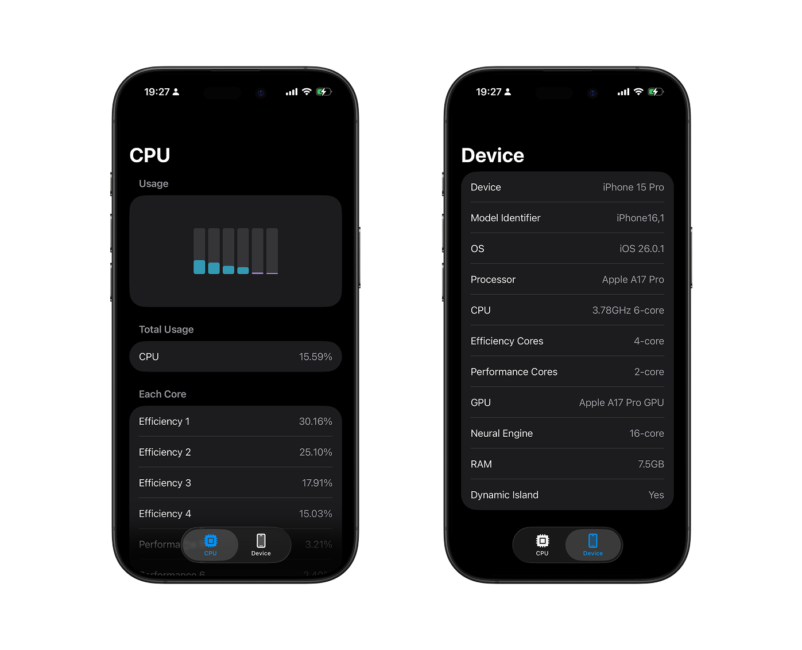
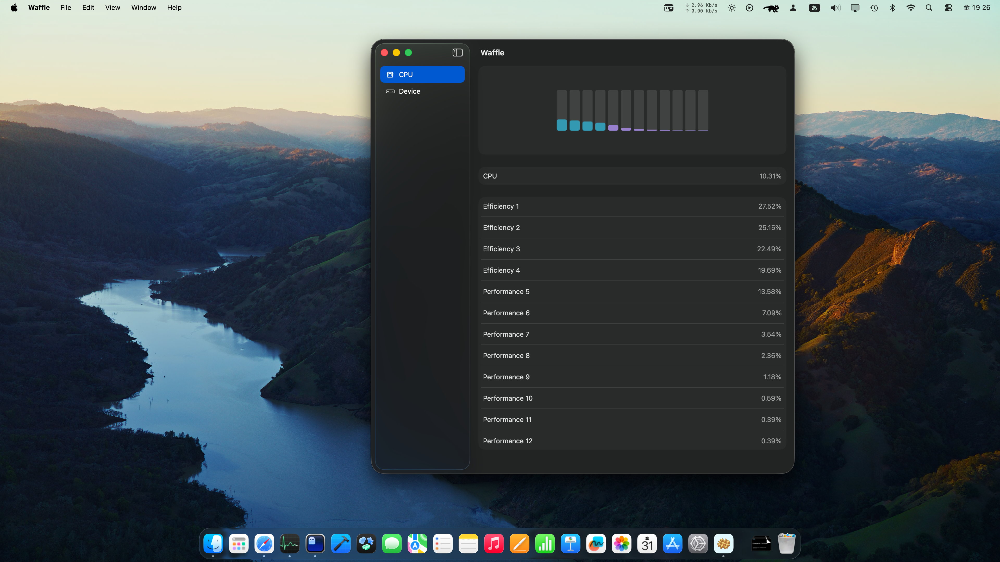
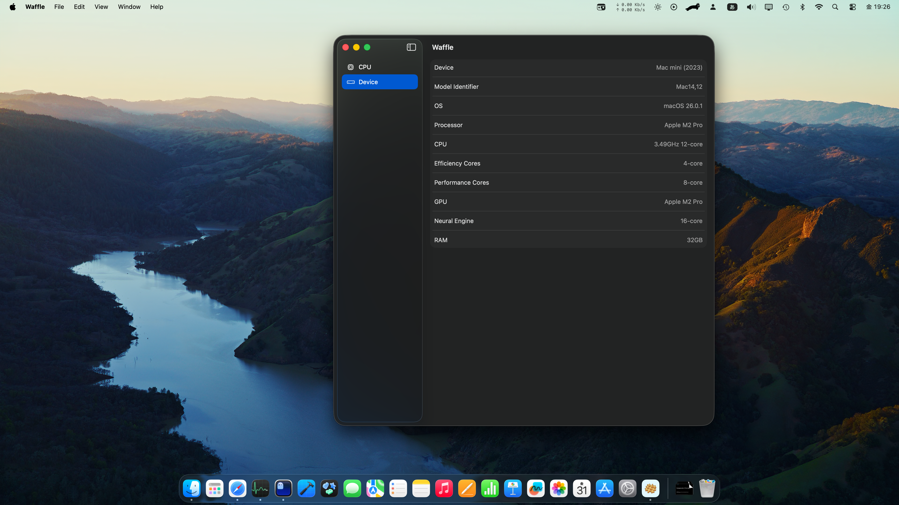

# Waffle

    

Waffle🧇 is the app for checking the load of each core of CPU. Also, you can check device information.

This app is similer to [Gaufre for macOS](https://github.com/Shakshi3104/Gaufre). So, the app name was derived from silicon "wafer".

## iOS

    

## macOS

    

    

## Requirements

- Xcode 15+
- macOS 14+
- iOS 17+

## Swift Package Dependencies

- [CoreWafer](https://github.com/Shakshi3104/CoreWafer)
    - [ProcessorKit](https://github.com/Shakshi3104/ProcessorKit)
    - [DeviceHardware](https://github.com/Shakshi3104/DeviceHardware)
